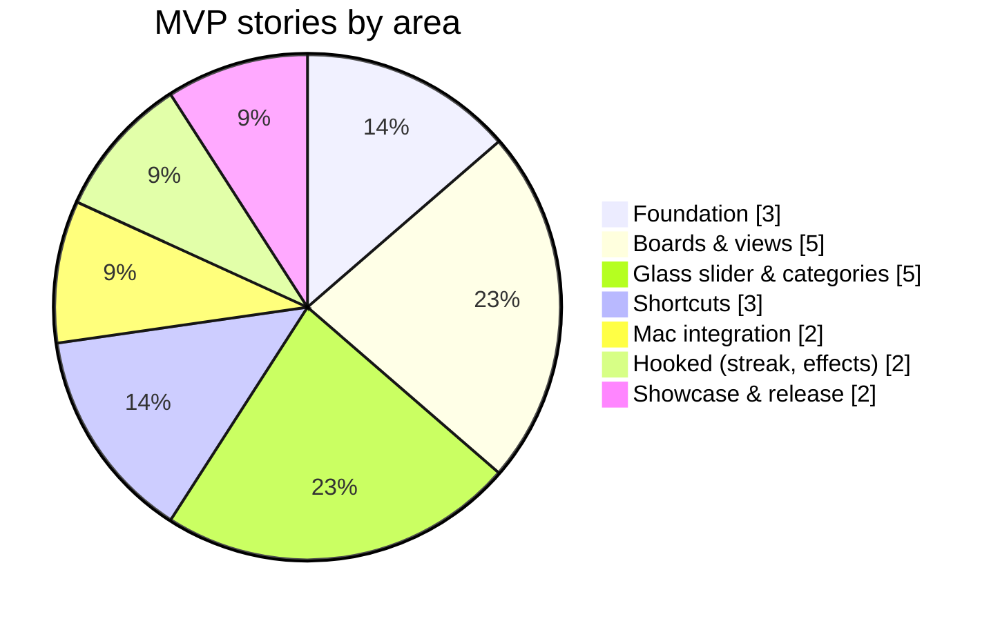

# 02 · Scope

Prioritised with **MoSCoW** for the MVP (v1.0, macOS). Anything not Must/Should is a candidate for a later release.

## Must (MVP is not done without these)

| Area | Feature |
|---|---|
| Foundation | macOS 26+ target, SwiftData model for Boards / Tasks / Categories / Shortcuts |
| Boards | Create, rename, delete boards in a sidebar |
| Views | Each board viewable as a **List** and as a **Kanban** (To Do · In Progress · Done) — same tasks, two views |
| Tasks | Create / edit / delete tasks: title, notes, due date, priority, category |
| Kanban | Drag cards between columns to change status |
| Glass slider | Liquid Glass progress slider: morphing glass thumb, tinted-glass card fill, trackpad haptics at 25/50/75 %, auto-move to Done at 100 % |
| Categories | Categories with a colour; the slider/card tint uses the category colour |
| Shortcuts | Attach URLs and apps to a task; show real app icon / site favicon; click to open |
| Mac | Menu bar quick-view (today's / in-progress tasks) |
| Mac | Global hotkey → quick-add panel from anywhere |
| Hooked | Daily streak (complete ≥1 task/day) + a visually satisfying completion effect |

## Should

| Area | Feature |
|---|---|
| Categories | Patterns per category (stripes, dots, waves…) layered in the glass fill |
| Mac | Keyboard shortcuts for everything (new task, switch view, move card) |
| Views | Filter/sort by category, priority, due date |
| Showcase | README with GIF, release build on GitHub Releases |

## Could

- Custom kanban columns per board
- Customisable hotkey recorder UI
- Streak calendar / heatmap
- Light/dark accent themes beyond system

## Won't (in v1.0) → planned later

| Release | Feature |
|---|---|
| v1.1 | Due-date notifications |
| v1.1 | Shortcuts/Siri via App Intents |
| v1.1 | Desktop / Notification Center widgets |
| v1.2 | iCloud sync (SwiftData + CloudKit) |
| v2.0 | iOS / iPadOS app |
| v2.0 | Files & folders as task shortcuts |
| v2.x | Deeper app integration: talk to the linked app's API or MCP server instead of just opening it |

## Scope at a glance

