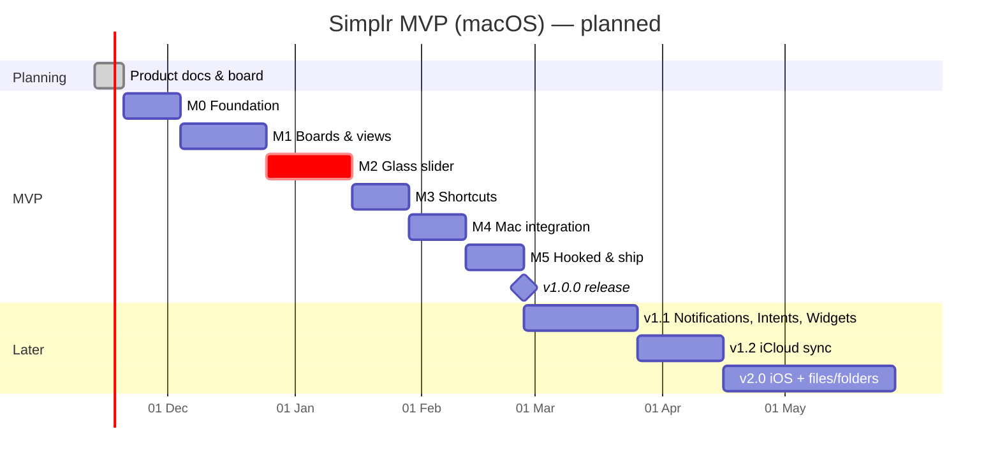
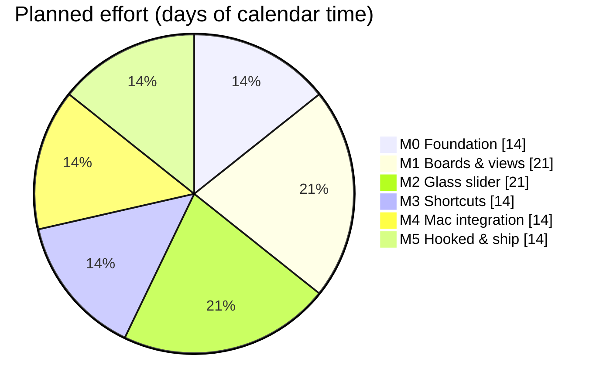
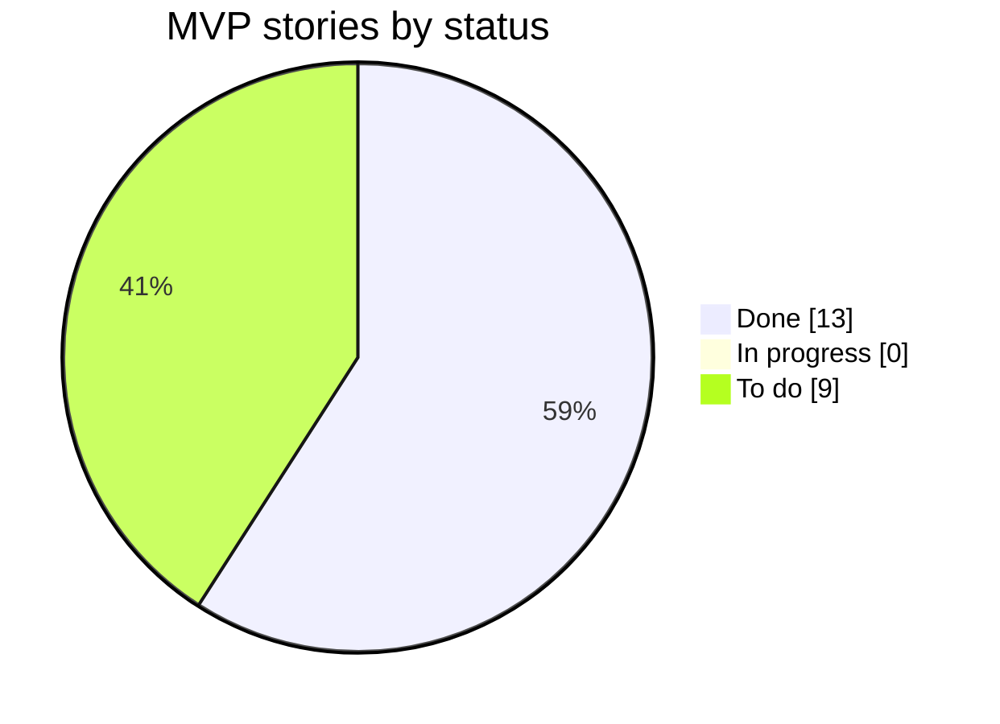

# 04 · Roadmap

Milestones are vertical slices: each one ends with something demoable. Dates assume **~5 h/week** — adjust when reality
disagrees and log the change in [Decisions](05-decisions.md).

| Milestone | Goal | Stories | Demo at the end |
|---|---|---|---|
| **M0 · Foundation** | Mac app skeleton on the new data model | F-1 → F-3 | Empty app with sidebar & glass toolbar |
| **M1 · Boards & views** | Real usable to-do app | B-1 → B-5 | Create a board, add tasks, switch List ↔ Kanban, drag cards |
| **M2 · Glass slider** | The signature interaction | G-1 → G-5 | Drag a glass slider, feel haptics, watch it auto-complete |
| **M3 · Shortcuts** | Tasks that take you somewhere | S-1 → S-3 | Click a favicon on a card → site opens |
| **M4 · Mac integration** | Lives in your Mac, not just a window | M-1, M-2 | Hotkey → add task → see it in the menu bar |
| **M5 · Hooked & ship** | Reasons to come back + public v1.0 | H-1, H-2, R-1, R-2 | GitHub Release `v1.0.0` |

## Timeline

M2 is marked critical: it's the riskiest (custom gesture + glass morphing + haptics) and the reason the app exists. If
time runs short, cut from M4/M5 *Should* items, never from M2.

## Effort by milestone

## Progress

Live status lives on the GitHub Project board (see [Board](07-board.md)). This chart is updated by hand at the end of
each milestone:

## Risks

| Risk | Likelihood | Mitigation |
|---|---|---|
| Liquid Glass APIs behave differently than expected for custom controls | Med | Spike G-1 early in M2; fallback to `.ultraThinMaterial` + custom shape |
| Global hotkey in a sandboxed app | Med | Use the `KeyboardShortcuts` package (Carbon hot-keys work in the sandbox) — see D-007 |
| Favicon fetching is flaky | Low | LinkPresentation first, `/favicon.ico` second, SF Symbol fallback |
| Scope creep ("just one more effect") | High | Anything new goes to the board as *Could*; only Musts block v1.0 |
| Side project loses momentum | Med | Small vertical slices; demo GIF per milestone keeps it rewarding |
